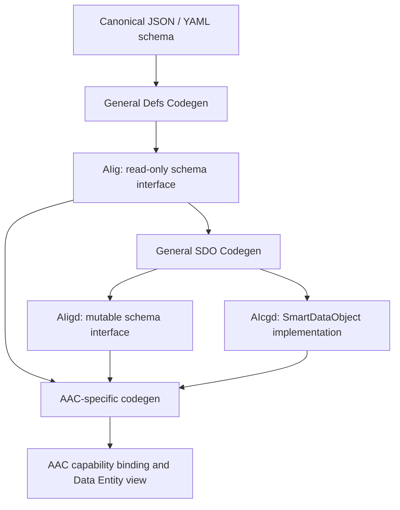

# AAC Code Generation — General 1.1

AAC owns generation of capability interfaces, typed caller facades, exception
factories and versioned Data Entity mutation views/codecs. It **does not**
generate or inline DTO declarations, duplicate schema getters or invent data
object names. This implementation uses the public General 1.1 pipeline:

1. `AIcJsonSchemaReader` normalizes the registered AAC schema, with its explicit
   `x-aac-schema-id` / `x-aac-schema-version` identity parameters.
2. `AIcSchemaContractInterfaceGenerator` (Defs stage) creates annotated
   `AIig*` read contracts. Its `AIcdGeneratedSource.primary_type` contains the
   importable qualified name, module, type role, technology and canonical ID.
3. `AIcSdoCodegenService` (SmartDataObject stage) consumes the AIig contract
   and emits separate `AIigd*` and `AIcgd*` modules with type identities.
4. The AAC binding generator imports the canonical generated types by their
   metadata. `AIcSmartDataObject.from_mapping()` / `to_mapping()` provide
   generic wire mapping; no AAC-specific DTO runtime is generated.

## Generation pipeline

The schema types are owned by General, not generated inline by AAC. The binding
and Data Entity generators import the fully qualified General type identities
rather than deriving class names from filename conventions.



The General SDO runtime also provides typed virtual mappings with preserved
concrete class and object identity (`toMapping_RawValues`,
`toMapping_EffectiveValues`, and `AIsSmartDataObjectFactory`). These virtual
mappings are **not** ordinary JSON dictionaries; a wire protocol must encode
schema and instance references separately. The existing AAC invocation's
plain mapping remains a wire-boundary adapter and does not guarantee
lossless cyclic/polymorphic graph transport.

## CLI

Generate a capability binding and standalone schema modules:

```sh
aaccodegen capability capability.yml --schema-dir schemas \
  --output generated/aiig_capability.py --generated-root generated
```

Generate a Data Entity mutation view/codec (inheriting the general AIig):

```sh
aaccodegen dataentity schema.json --schema-id example.entity \
  --schema-version 1 --output generated/entity_view.py --generated-root generated
```

The `--generated-root` must be a Python source root on the consumer's module
search path; the generated `eu/algites/frmw/aac/generated/` package is placed
beneath it. Generated sources are build outputs, not handwritten repo sources.
Different AAC bindings sharing the same canonical definition should consume
one common set of generated modules; the CLI rejects incompatible duplicate
module contents at the same output path.

`generate()` on either Python generator returns only the AAC-specific binding
source. To obtain its required separately importable schema modules, use
`generate_sources()` (or the CLI), which returns `binding_source` and
`schema_sources`. Calling `generate()` alone does not install its dependencies.

### Compatibility notes

- `AIcGeneralDefsInlineDtoAdapter` was removed, not preserved as an alias.
- Older generated single-file bindings containing `AIcgd` classes must be
  regenerated. Data Entity mutation views now use `AIig<Name>DataEntityView_N`
  and inherit the general `AIig<Name>_N` getters/metadata; only setter methods
  and codec behavior are AAC-specific.
- `AIcgd` is the General SmartDataObject, not the legacy immutable dataclass.
  Fields are initialized via `from_mapping()` or generated setters, and converted
  using `to_mapping()`.
- A generated schema may require referenced contracts to be available during
  the General stage; unknown external references are not silently inlined.
